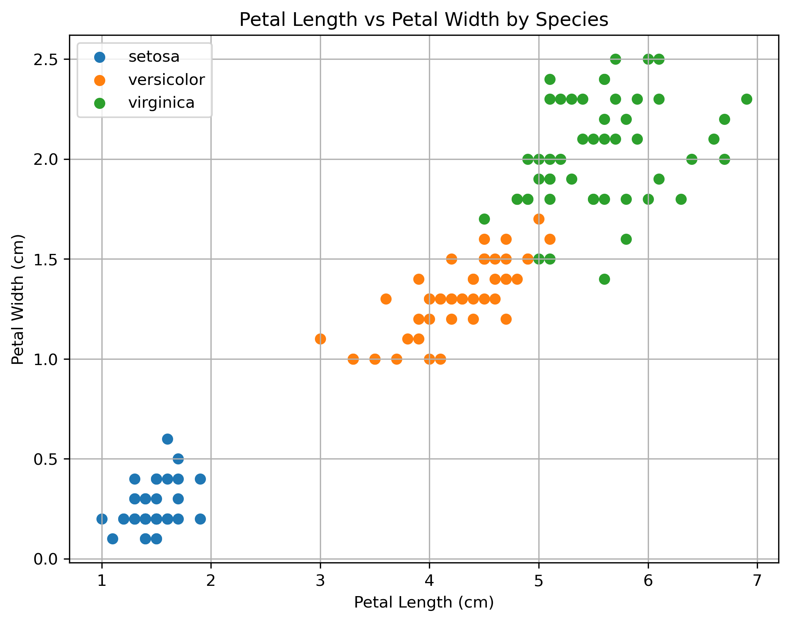
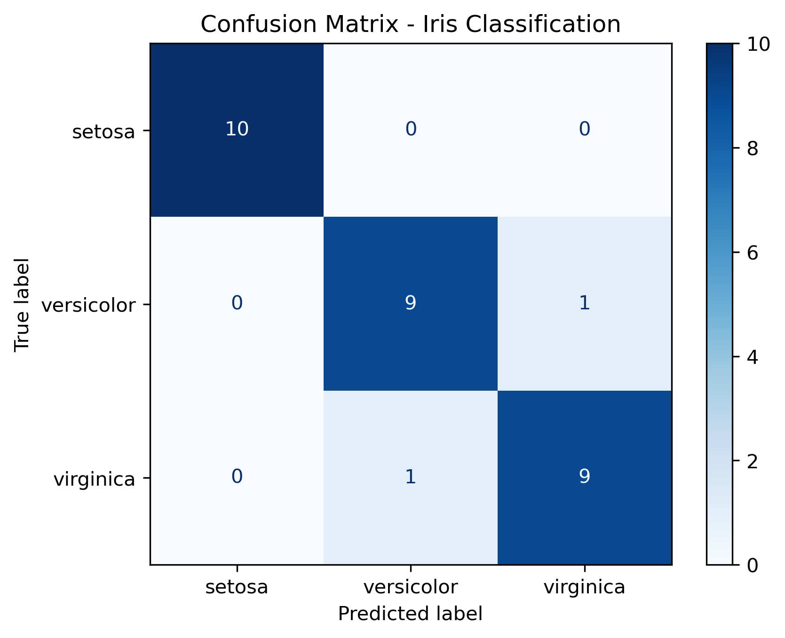
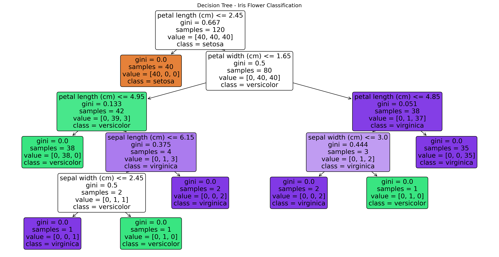
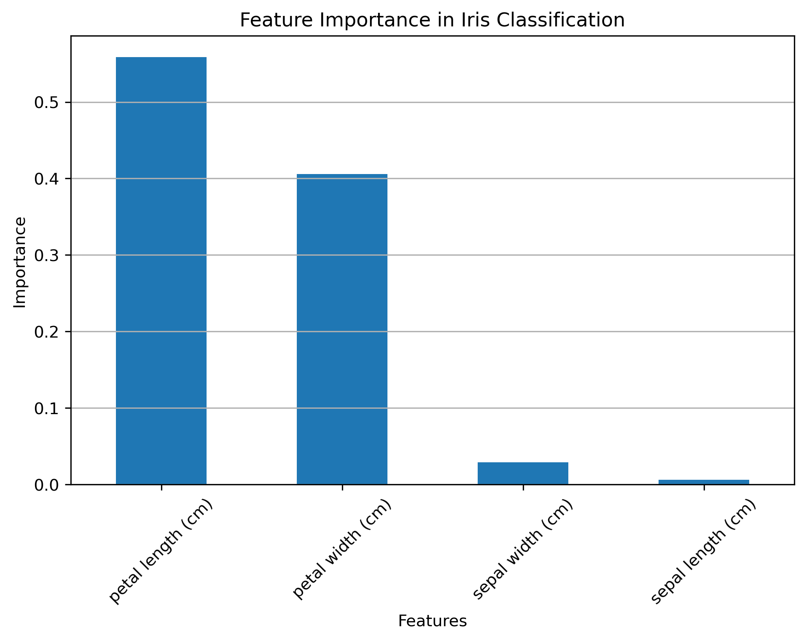

# Iris Flower Classification 

A Machine Learning project that uses the Iris dataset to classify flowers into three different species based on their physical measurements.

This project demonstrates a basic supervised machine learning workflow, including data exploration, model training, prediction, evaluation, and visualization.

## Project Overview

The objective of this project is to build a classification model that can identify the species of an Iris flower using four measurements:

- Sepal length
- Sepal width
- Petal length
- Petal width

The model predicts one of three Iris species:

- Setosa
- Versicolor
- Virginica

## Dataset

This project uses the Iris dataset provided by Scikit-learn.

The dataset contains:

| Description | Value |
|---|---:|
| Total samples | 150 |
| Features | 4 |
| Target classes | 3 |
| Missing values | 0 |

### Input Features

1. Sepal length (cm)
2. Sepal width (cm)
3. Petal length (cm)
4. Petal width (cm)

### Target Classes

The target variable represents the flower species:

- 0: Setosa
- 1: Versicolor
- 2: Virginica

## Technologies Used

The following Python libraries and tools were used:

- **Python** – Programming language.
- **Pandas** – Data manipulation and analysis.
- **Matplotlib** – Data visualization.
- **Scikit-learn** – Dataset loading, model training, prediction, and evaluation.
- **Jupyter Notebook** – Interactive development environment.
- **VS Code** – Code editor.

## Machine Learning Workflow

The project followed these steps:

### 1. Data Exploration

Explored the Iris dataset to understand its structure and identify potential data quality issues.

Some operations performed included:

- Viewing the first five rows.
- Checking the dataset shape and column names.
- Checking for missing values.
- Examining the distribution of flower species.

### 2. Feature and Target Selection

Separated the dataset into input features (X) and target labels (y).

- **X:** Four flower measurements.
- **y:** Iris species labels.

### 3. Train-Test Split

Divided the dataset into training and testing subsets using Scikit-learn's `train_test_split()`.

- Training data: 120 samples (80%).
- Testing data: 30 samples (20%).

Used `random_state=42` to make the split reproducible and `stratify=y` to preserve class proportions.

### 4. Model Training

Used a Decision Tree Classifier from Scikit-learn.

The model was trained using the training data with:

```python
model.fit(X_train, y_train)
```

### 5. Prediction

Used the trained model to predict the flower species in the testing dataset:

```python
model.predict(X_test)
```

### 6. Model Evaluation

Evaluated the predictions using:

- Accuracy score.
- Classification report (precision, recall, and F1-score).
- Confusion matrix.

## Model Performance

The Decision Tree Classifier achieved an accuracy of **93.33%** on the test dataset.

### Classification Results

| Metric | Score |
|---|---:|
| Accuracy | 93.33% |
| Macro Precision | 0.93 |
| Macro Recall | 0.93 |
| Macro F1-score | 0.93 |

### Performance by Species

| Species | Precision | Recall | F1-score |
|---|---:|---:|---:|
| Setosa | 1.00 | 1.00 | 1.00 |
| Versicolor | 0.90 | 0.90 | 0.90 |
| Virginica | 0.90 | 0.90 | 0.90 |

The model correctly classified 28 out of 30 test samples, making two incorrect predictions.

Setosa was classified perfectly, while Versicolor and Virginica each had one incorrectly classified sample.

## Visualizations

The project includes the following visualizations to better understand the dataset and the trained model.

### 1. Petal Length vs Petal Width

This scatter plot shows how the three Iris species are distributed based on their petal measurements.



### 2. Confusion Matrix

The confusion matrix shows the number of correct and incorrect predictions for each flower species.



### 3. Decision Tree Visualization

This visualization displays the decision rules learned by the Decision Tree Classifier.



### 4. Feature Importance

This chart shows the relative importance of each flower measurement in the Decision Tree's predictions.



## Conclusion

This project provided practical experience with the fundamental concepts of supervised machine learning.

Through the Iris Flower Classification task, I learned how to explore a dataset, prepare features and target labels, train a classification model, make predictions, evaluate performance, and visualize results.

The Decision Tree Classifier achieved 93.33% accuracy on the test dataset, demonstrating how machine learning can identify patterns in data and use them to make predictions.

## How to Run the Project

### 1. Clone the repository

```bash
git clone YOUR_GITHUB_REPOSITORY_URL
```

### 2. Navigate to the project directory

```bash
cd task-1-iris-classification
```

### 3. Install the required libraries

```bash
pip install -r requirements.txt
```

### 4. Open the notebook

Open `Iris_Flower_Classification.ipynb` in VS Code or Jupyter Notebook.

### 5. Run the cells

Execute the notebook cells sequentially to explore the dataset, train the model, generate predictions, and view the evaluation results.

## Author

**Beimnet Tadesse**

GitHub: [BeimnetTadesse](https://github.com/BeimnetTadesse)